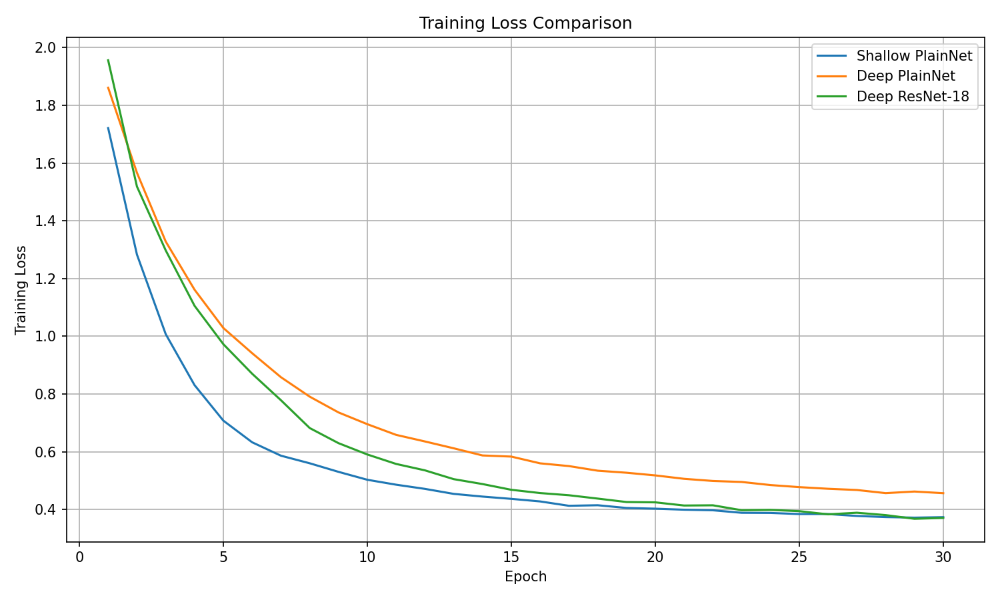
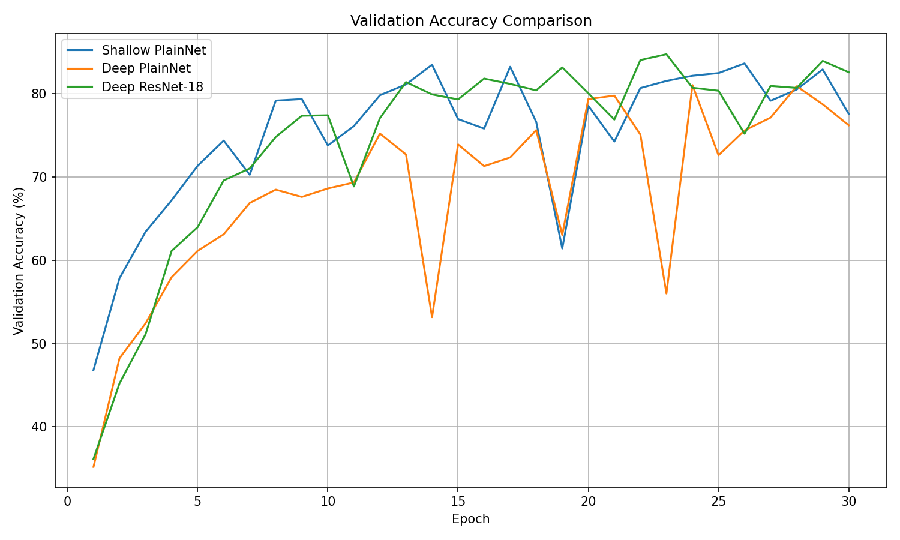

# ResNet-18 and the Degradation Problem 

## Overview
This project investigates the **degradation problem** in deep neural networks using the CIFAR-10 dataset. When standard convolutional networks (PlainNets) become too deep, accuracy saturates and then rapidly degrades—not due to overfitting, but due to optimization difficulties. 

To demonstrate this, I built and trained three models from scratch using PyTorch:
1. **Shallow PlainNet:** A baseline convolutional network.
2. **Deep PlainNet:** A deeper version of the baseline without skip connections.
3. **Deep ResNet-18:** A residual network of the same depth as the Deep PlainNet, utilizing identity shortcut connections.

## Dataset
This project utilizes a custom-hosted version of the CIFAR-10 dataset. If you are running this notebook locally or in your own Kaggle environment, you can access and download the dataset here:
* [**CIFAR-10 Custom Dataset** (Kaggle)](https://www.kaggle.com/datasets/mariamtobar/cifar10-custom)

## Key Features
* **Custom Architecture Implementations:** Built `BasicBlock` and `PlainBlock` modules from scratch to construct the ResNet and PlainNet architectures.
* **Data Augmentation:** Applied `RandomCrop` and `RandomHorizontalFlip` with custom normalization.
* **Custom Training Loop:** Implemented a robust training loop with SGD, momentum, weight decay, and automatic checkpointing.
* **Deterministic Splitting:** Seed-based `Subset` splitting to ensure perfectly reproducible 45k/5k train/validation splits.

## Results & The Degradation Problem
The training loss curves clearly illustrate the degradation problem. The **Deep PlainNet** exhibits a higher training loss than the **Shallow PlainNet**, despite having more parameters and capacity. However, the **Deep ResNet-18** successfully overcomes this optimization hurdle via residual connections, achieving the lowest training loss and converging efficiently.

### Learning Curves
<div align="center">
  
  
</div>

## Repository Structure
* `/notebooks`: Contains the main Jupyter notebook with the full pipeline.
* `/plots`: Visualizations of training/validation accuracy and loss.
* `/docs`: Contains `Project_11.pdf`, detailing the theoretical background.

## Installation & Usage
1. Clone this repository:
   ```bash
   git clone [https://github.com/1793468/resnet-degradation-cifar10.git](https://github.com/1793468/resnet-degradation-cifar10.git)
   cd resnet-degradation-cifar10